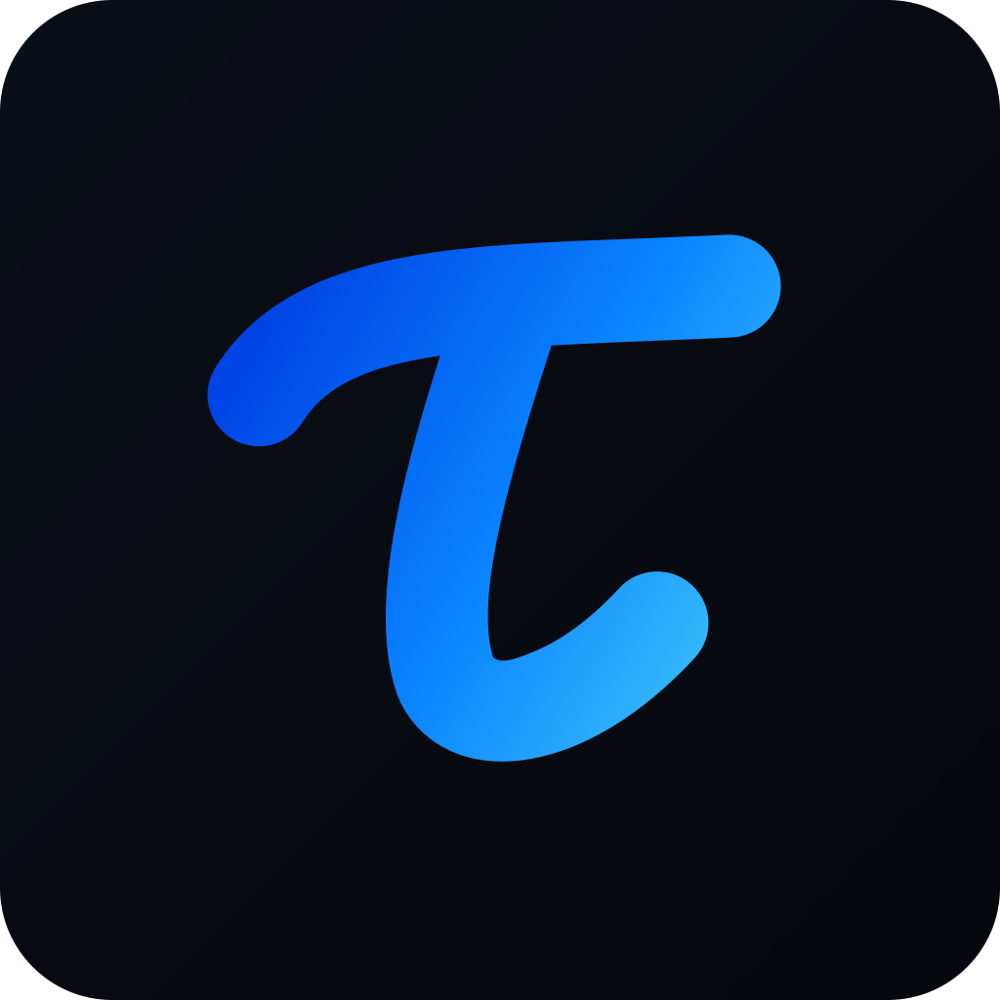
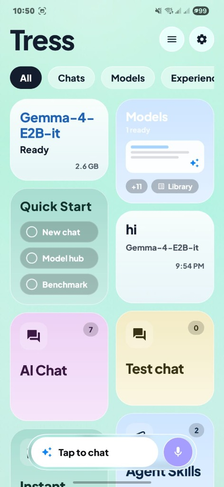
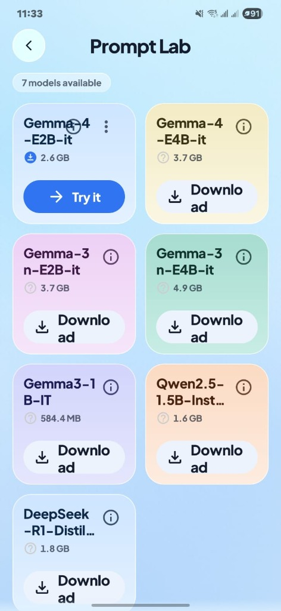
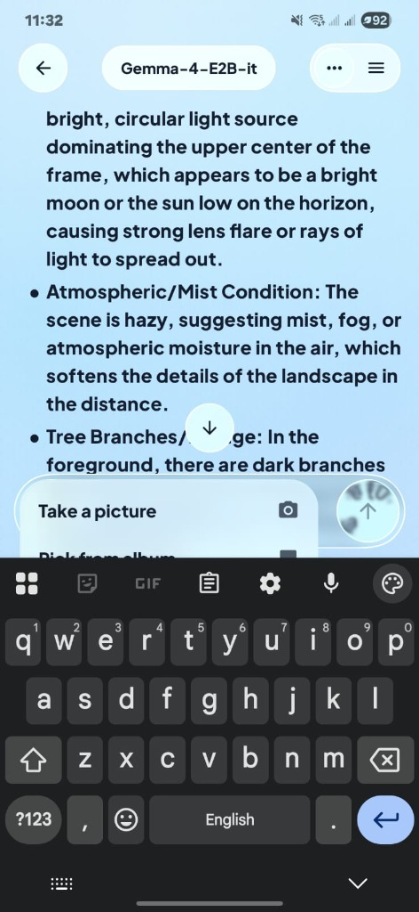
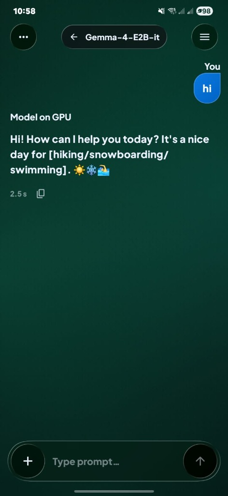
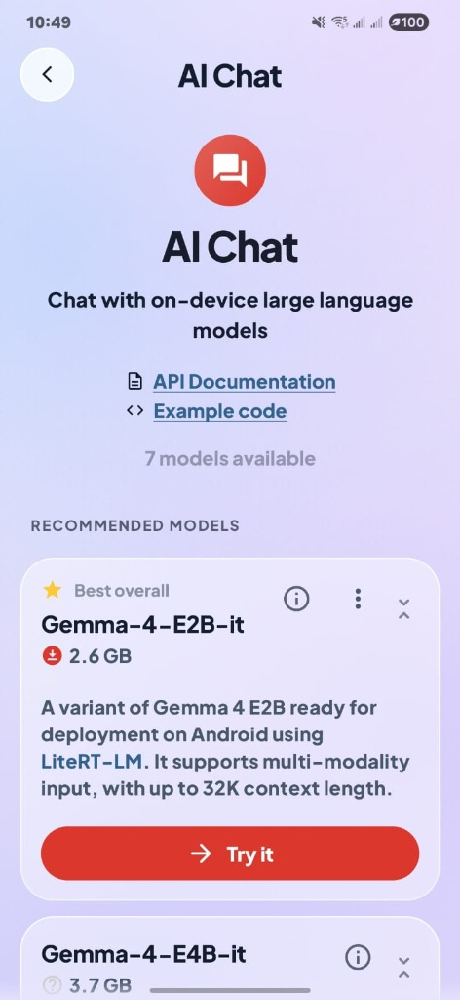
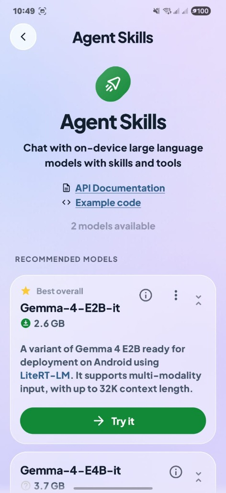
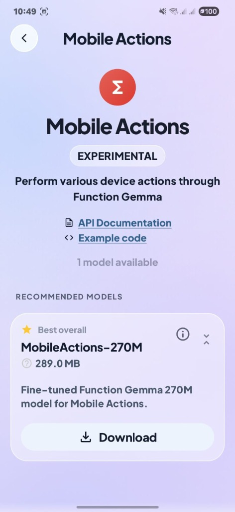
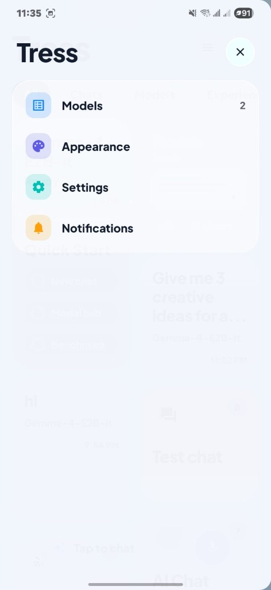

<p align="center">
  
</p>

<h1 align="center">Tress</h1>

<p align="center">
  <strong>Private, offline-first on-device AI workspace for Android</strong><br/>
  Powered by LiteRT-LM, Gemma, Qwen, DeepSeek &amp; modular Agent Skills — wrapped in a minimal, fast Bento &amp; Liquid Glass UI.
</p>

<p align="center">
  <a href="LICENSE"></a>
  
  
</p>

---

## Overview

**Tress** runs open-weight multimodal Large Language Models directly on your phone's CPU/GPU/NPU—with zero cloud lock-in, zero analytics trackers, and full offline privacy.

It reimagines local AI on Android with:
- **Bento Workspace & Neutral UI**: Compact 2-column Bento grid with restrained shadcn/ui-inspired Zinc & Slate contrast, theme presets, and custom appearance controls.
- **Persistent Chat History & Sessions**: Resume previous conversations seamlessly across AI Chat, Test Chat, and Agent Skills.
- **Multimodal & Voice Ready**: Image understanding, audio clips, on-device speech recognition (ASR) dictation, text-to-speech playback, and camera capture directly inside a floating glass composer.
- **Modular Agent Skills & MCP**: Extend local models with tools, web/local workflows, Prompt Lab parameter tuning (`temperature`, `top-k`), and on-device benchmarking.

---

## Screenshots

<p align="center">
  
  
  
  
</p>

<details>
<summary>More screens</summary>

<p align="center">
  
  
  
  
</p>

</details>

---

## Brand Assets

High-resolution logo files exported in [`assets/`](assets/):
- [`assets/tress-logo.png`](assets/tress-logo.png) — 1024×1024 transparent mark
- [`assets/tress-app-icon.png`](assets/tress-app-icon.png) — 1024×1024 rounded app icon
- [`assets/tress-logo.svg`](assets/tress-logo.svg) — Scalable vector mark

---

## Core Capabilities

- **AI Chat & Multimodal Ask**: Chat with `Gemma 4`, `Gemma 3n`, `Qwen 2.5`, and `DeepSeek-R1` distilled models locally with image & audio inputs.
- **Agent Skills**: Connect local LLMs to structured tools and modular skills (`skills/`).
- **Prompt Lab**: Rapid single-turn evaluation across models with configurable decoding settings.
- **Instant Media Search & Video Moment Finder**: Semantic search over local media using on-device embeddings.
- **Audio Scribe & XR Language Teacher**: Real-time local transcription, translation, and interactive language study.
- **Hardware Benchmarking**: Measure prefill/decode tokens per second and latency directly on device.

---

## Building Locally

### Requirements
- Android Studio / JDK 21
- Android SDK (compileSdk 37 / Android 12+ target device)

### Build & Test
```bash
cd Android/src
./gradlew :app:testDebugUnitTest
./gradlew :app:assembleDebug
./gradlew :app:assembleRelease
```

---

## License

Apache License 2.0 — see [`LICENSE`](LICENSE) for details.
